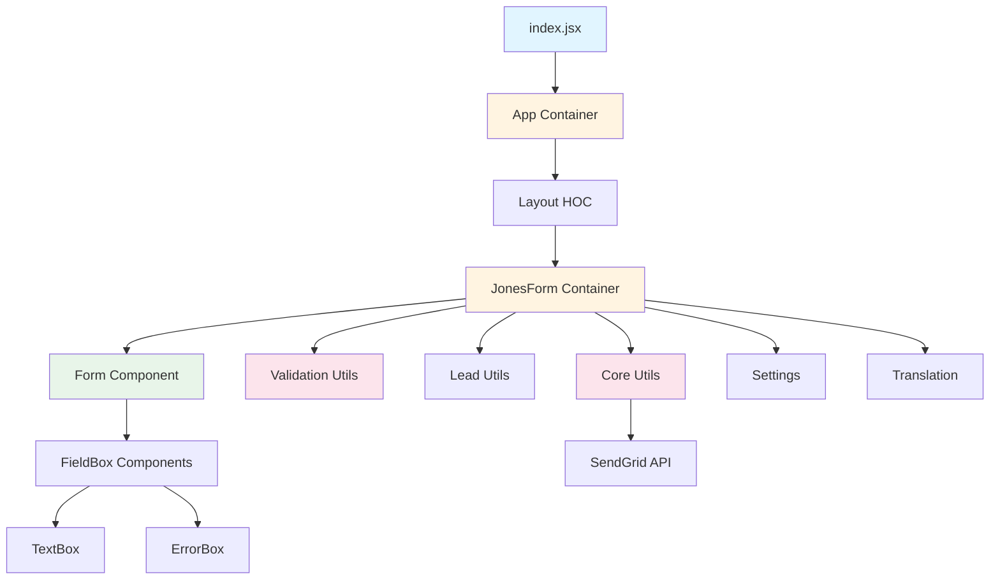
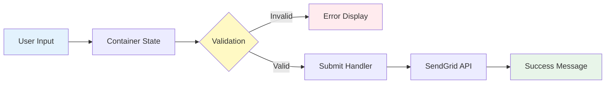

# Simple Form

A React.js form submission application with client-side validation and SendGrid email integration.

Built in November 2018. This application demonstrates a modern React form with comprehensive field validation, user-friendly error messages, and asynchronous email submission capabilities.

## Features

- 📝 Clean and intuitive form interface ("Jones Form")
- ✅ Real-time field validation with descriptive error messages
- 📧 SendGrid API integration for email notifications
- 🎨 Responsive design with Bootstrap
- 🔄 Loading states and success feedback
- 🌐 Service Worker for PWA capabilities
- 🎯 PropTypes validation for type safety
- 💅 Custom styling with LESS

## Getting Started

### Prerequisites

- Node.js (v8 or higher)
- npm or yarn
- Modern web browser

### Installation

1. Clone the repository:
```bash
git clone https://github.com/orassayag/simple-form.git
cd simple-form
```

2. Install dependencies:
```bash
npm install
```

3. Start the development server:
```bash
npm start
```

The application will automatically open in your browser at `http://localhost:3000`.

### Configuration

Configure SendGrid API key in the settings files:
- Development: `src/settings/settings.development.json`
- Production: `src/settings/settings.production.json`

```json
{
  "sandgrid_api_key": "your-api-key-here"
}
```

**Important Note:** SendGrid email sending from the frontend is blocked by CORS. A backend server is required for production email functionality. See the [SendGrid CORS documentation](https://sendgrid.com/docs/for-developers/sending-email/cors) for more details.

## Available Scripts

### Development
Start the development server with hot reloading:
```bash
npm start
```

### Build
Create an optimized production build:
```bash
npm run build
```

### Test
Run the test suite:
```bash
npm test
```

## Project Structure



## Form Validation

The form includes comprehensive validation for all fields:

### First Name & Last Name
- ✓ Required field
- ✓ English letters only (A-Z, a-z)
- ✓ Minimum 2 characters

### Email
- ✓ Required field
- ✓ Valid email format validation
- ✓ Regex pattern matching

### Phone Number
- ✓ Required field
- ✓ Digits only (0-9)
- ✓ Exactly 10 digits

## Architecture



### Component Hierarchy

```
App (Container)
└── Layout (HOC)
    └── JonesForm (Container)
        ├── PageTitle
        └── Form (Component)
            ├── FieldBox × 4
            │   ├── Label
            │   ├── TextBox
            │   └── ErrorBox
            ├── SubmitButton
            ├── Loader
            └── ErrorBox (General)
```

### Data Flow

1. **User Input** → Component state updates via `handleFormInputChange`
2. **Form Submit** → Validation via `validateLead` utility
3. **Validation Pass** → SendGrid email sending (simulated)
4. **Success** → Form reset + success message display

## Technology Stack

- **Frontend Framework:** React 16.5.2
- **State Management:** Component State (Class Components)
- **Routing:** React Router 4.3.1
- **Styling:** LESS + Bootstrap
- **Build Tool:** Webpack 4.19.1
- **Email Service:** SendGrid API
- **Type Checking:** PropTypes
- **Service Worker:** sw-precache-webpack-plugin

## File Structure

```
simple-form/
├── public/                  # Static assets
│   ├── index.html          # HTML template
│   └── assets/             # CSS libraries and fonts
├── src/
│   ├── components/         # Reusable components
│   │   ├── JonesForm/     # Form-specific components
│   │   │   ├── FieldBox/  # Form field wrapper
│   │   │   └── Form/      # Main form component
│   │   └── UI/            # Generic UI components
│   ├── containers/         # Stateful containers
│   │   ├── App/           # Root container
│   │   └── JonesForm/     # Form logic container
│   ├── hoc/               # Higher-Order Components
│   │   ├── Auxiliary/     # Fragment wrapper
│   │   └── Layout/        # Layout wrapper
│   ├── models/            # Data models
│   │   ├── Lead.js
│   │   ├── KeyValuePair.js
│   │   └── LeadValidationResult.js
│   ├── settings/          # Configuration
│   ├── translate/         # Internationalization
│   ├── utils/             # Utility functions
│   │   ├── validationUtils.js
│   │   ├── leadUtils.js
│   │   ├── coreUtils.js
│   │   └── textUtils.js
│   ├── index.jsx          # Entry point
│   └── index.less         # Global styles
├── config/                # Build configuration
├── scripts/               # Build scripts
└── package.json
```

## Contributing

Contributions are welcome! Please read the [CONTRIBUTING.md](CONTRIBUTING.md) file for details on how to contribute to this project.

See [INSTRUCTIONS.md](INSTRUCTIONS.md) for detailed setup and development instructions.

## Known Limitations

1. **CORS Issue:** SendGrid API calls from the frontend are blocked by CORS policy. A backend server is required for production use.
2. **Sequential Validation:** The form validates one field at a time rather than showing all errors simultaneously.
3. **Email Simulation:** Currently, email sending is simulated with a timeout due to CORS restrictions.

## Future Enhancements

- Backend server for email sending
- Multi-field validation display
- Additional form fields
- Form submission history
- Internationalization support
- Automated testing suite
- Accessibility improvements

## Browser Support

This application supports:
- ✓ Chrome (latest)
- ✓ Firefox (latest)
- ✓ Safari (latest)
- ✓ Edge (latest)
- ✗ Internet Explorer 11 and below
- ✗ Opera Mini

## Author

* **Or Assayag** - *Initial work* - [orassayag](https://github.com/orassayag)
* Or Assayag <orassayag@gmail.com>
* GitHub: https://github.com/orassayag
* StackOverflow: https://stackoverflow.com/users/4442606/or-assayag?tab=profile
* LinkedIn: https://linkedin.com/in/orassayag

## License

This application has an MIT license - see the [LICENSE](LICENSE) file for details.
